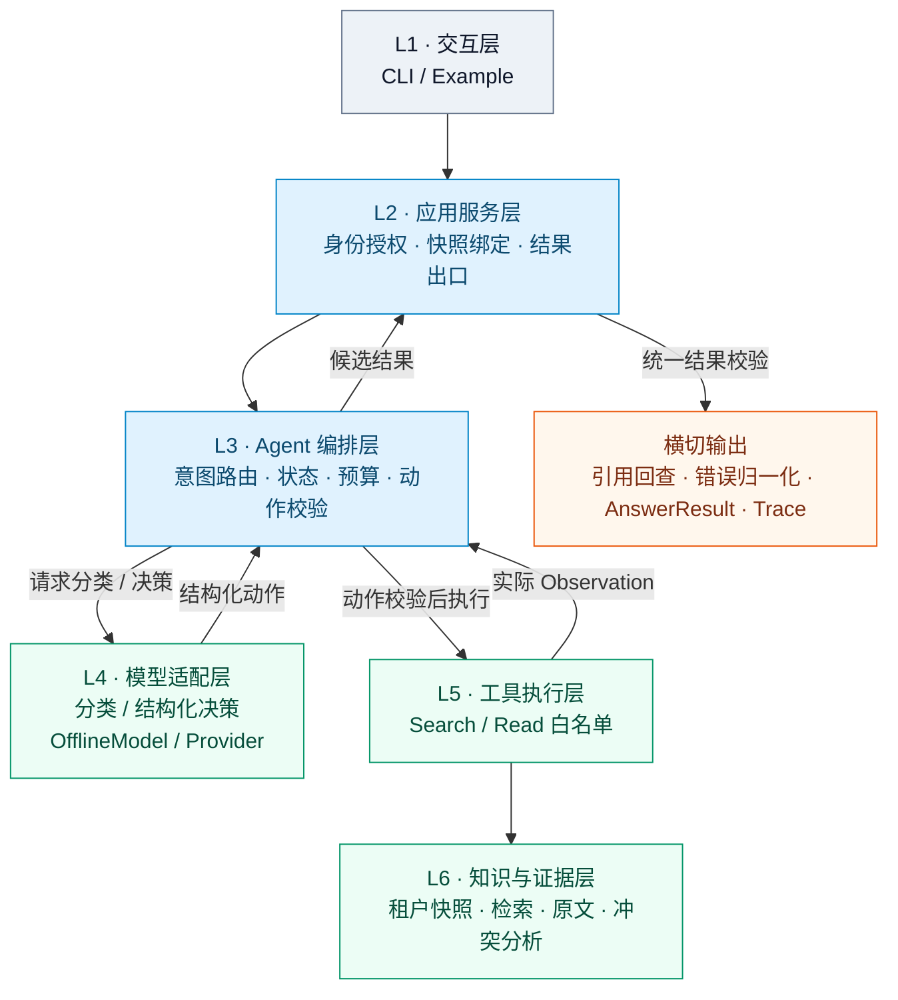

# 02 方案、调用流程与技术取舍

## 1. 架构总览

本项目采用“六层职责 + 横切约束”的结构。六层负责业务职责，横切能力负责把权限、
预算、错误、证据和可观测性贯穿到底。这样既能保持 CLI 首版足够轻量，又为真实模型、
向量后端和多租户运行保留清晰替换点。



上图表达职责与主要调用关系，不是六层依次串行执行：L4 与 L5 都由 L3 调用，
模型不直接执行工具；L2 在知识路径中绑定快照并完成结果校验。
`TenantContext`、预算和 Trace 贯穿请求。图中的真实 provider 与向量后端是适配边界，
不代表本轮已有真实运行证据；不支持 Mermaid 的阅读器可直接查看下方职责表与数据流。

### 1.1 三条设计主线

| 主线 | 关键问题 | 设计回答 |
|---|---|---|
| 决策主线 | Agent 为什么继续、追问或结束？ | 模型动作必须基于当前 Observation，并经过状态与预算校验 |
| 证据主线 | 答案凭什么成立？ | `SearchCandidate → ReadEvidence → Claim/Citation`，最终结果统一回查 |
| 隔离主线 | 谁能看到哪些资料？ | 可信身份确定租户，TenantContext 贯穿索引、检索、原文、证据和 Trace |

### 1.2 分层取舍

- **不直接引入 Agent 框架**：首版用原生 Python 表达状态和契约，降低安装成本并方便审查；
- **不让模型直接操作基础设施**：模型只能选择白名单动作，管理摄取和删除入口独立存在；
- **不把 Mock 当生产能力**：离线路径负责流程复现，真实 provider、Qdrant 和 CUDA 保留适配边界；
- **不把横切能力塞进单一层**：权限、预算、错误和 Trace 在服务、运行时、工具和结果校验
  处分别设门禁，避免某一层绕过约束。

## 2. 实现方式

使用原生 Python 组织运行循环，离线路径仅依赖标准库，不使用 LangGraph、ADK 或
其他 Agent 框架。框架职责由小型应用服务、编排器、工具路由和 dataclass 契约承担。
此选择降低评审环境准备成本，也便于逐步检查动作、观察、引用和停止条件。

现行设计固定为六层；结果校验、错误归一化和 Trace 是横切能力，不是独立业务层。

| 层 | 实现文件 | 职责 |
|---|---|---|
| L1 交互层 | `cli.py`、`configuration.py` | 参数、配置和 JSON 输出 |
| L2 应用服务层 | `service.py` | 校验请求、可信身份、快照绑定、唯一最终出口 |
| L3 Agent 编排层 | `orchestrator.py`、`runtime.py`、`routing.py` | 路由准备、有限循环、状态与预算 |
| L4 模型适配层 | `models.py`、`provider.py` | 分类和结构化动作；Mock 与真实 provider 分离 |
| L5 工具执行层 | `tools.py` | Search/Read 白名单、参数校验、Observation 登记 |
| L6 知识与证据层 | `knowledge.py`、`retrieval.py`、`vector_store.py`、`ingestion.py` | 资料快照、召回、读取、冲突、发布和删除 |

`contracts.py` 定义共享对象，`identity.py` 处理可信成员资格，`results.py` 负责结果组装
与来源回查，`trace.py` 写出外部事件。完整逐层、逐状态、逐工具设计见
[架构导航](../架构文档/README.md)。

## 3. 一轮请求的数据流

```text
CLI / example
  → ApplicationService：校验请求和身份
  → prepare_route：补用户历史指代、分类、选择路由
  → 非事实白名单：模板回答，跳过资料加载
  → 知识路径：绑定当前租户快照，准备 Search/Read
  → AgentOrchestrator：消费模型预算，请求模型动作
      → validate_action
      → Search / Read：消费工具预算，执行并登记 Observation
      → 将实际观察交回模型，再次选择动作
      → ask_clarification / finish / 预算耗尽 / 错误
  → ApplicationService.finalize：统一回查来源、校验结果
  → AnswerResult + Trace
```

分类同样计入模型次数。默认最多 6 次模型调用、4 次工具调用；快转深不重置计数。
预算耗尽返回 `incomplete / budget_exhausted`，并保留已执行步骤。

生命周期为 `RECEIVED → VALIDATED → DECIDING ↔ OBSERVING → RESULT_VALIDATION →
TERMINATED`。它与最终业务 `status`、回复路由不同，不能混用。

## 4. 工具与证据链

- `search_documents(query, filters?, limit?)` 返回当前请求授权的候选片段；
- `read_document(candidate_id)` 只读取已授权候选对应的原文章节；
- `ask_clarification` 和 `finish` 是模型控制动作，不是业务工具。

证据链为 `SearchCandidate → ReadEvidence → Claim/Citation`。身份、请求和快照贯穿
候选与证据；候选 snippet 不可直接进入最终引用。最终结果会回查文档 ID、版本、
章节和原文是否一致。历史助手文本不作为制度证据。

运行时限制模型只能调用 Search/Read，不允许任意 Shell、网络、路径或管理操作。
所有工具返回（包括可恢复错误）先转换为 Observation，工具失败不自动重放。

## 5. 观察驱动与 Mock 边界

两条已记录的 Mock 路径：

```text
单来源：Search → Read(D01) → Finish(completed)
双来源：Search → Read(D01) → Read(D02) → Finish(needs_clarification)
```

故障路径为 `Search(error) → Finish(execution_error)`。OfflineModel 读取本次真实工具
观察后使用规则选择下一动作；工具结果和日志不是预填值。但它仍是规则 Mock，
不满足“以固定条件分支证明真实模型 ReAct”的解释，不能当作真实模型决策效果证据。

ProviderModel 已有 HTTPS chat-completions JSON 接口，冻结约束和样例放在前缀，
动态上下文放在 user 消息。每次动作请求只投影当前请求的观察、候选、已读证据、
冲突与剩余预算；服务不可用或响应不符合协议时明确失败，不静默切换 Mock。
该适配器尚未发起真实调用。

## 6. 检索、冲突和路由

离线 fixture 使用词项匹配和合成资料。Qdrant local + CUDA BGE + RRF 混合召回已有
适配器与入口，但尚无真实运行证据；二者通过 `--retrieval fixture|hybrid` 明确选择，
不是无提示的后端回退。`requirements.txt` 列明可选依赖，但不声称有已验证版本组合。

路由包括 `fast_nonfactual`、`fast_faq`、`deep_query` 和 `fallback`。FAQ 事实快答
仍需 Search/Read，冲突、缺条件或候选覆盖不完整时不能直接输出确定答案。

D01 的 30 天和 D02 的 15 天在没有明确范围/优先级时保留双方证据并追问；
较新的日期本身不是覆盖关系。只根据显式 `supersedes`、明确优先级和适用条件选择来源。
当前 Mock 冲突分析依赖结构化字段和简单数字规则，不具备通用语义裁决能力。

## 7. 条件、身份与管理边界

`--history <JSON文件>` 接受至多 12 条 user/assistant 消息。调用方提供的
`--filters <JSON文件>` 可指定已确认的范围、文档和日期；模型不能擅自扩大这些条件。
撤回制度查询必须明确历史模式及参考生效日期。自然语言条件自动确认尚未实现。

`--principal` 和 `--tenant` 只选择可信配置中已有的成员资格，不提供生产认证。
`admin.py` 提供摄取、发布、删除和擦除的独立管理入口；这些操作不向模型开放。
发布和擦除续清理只有替身局部证据，不证明真实向量删除或跨进程一致性。

## 8. 结果、Trace 与取舍

最终结果包含回答、文档 ID/版本/章节/原文、缺口、状态、冲突、错误码和停止原因。
Trace 保留步骤、动作参数、返回摘要、观察 ID、下一动作和预算计数。
`decision_basis_summary` 是运行时观察摘要，不是模型生成原因，也不是内部思维链。

选择 CLI 和标准库 Mock 是为了在没有可用模型/真实资料时交付可复查核心，而不是
把离线实验包装成生产系统。UI、部署、多 Agent 和生产 Runtime 不属于当前交付目标。
